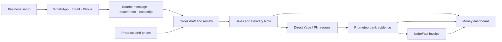

# Cedar product architecture

Cedar is the development candidate for a merchant’s order intake, fulfilment and money workspace.
The full preview is [demo.soyrocoto.com/cedar](https://demo.soyrocoto.com/cedar/). Its UI, prototype
API, private provider services and seeded scenarios form one owned development experience.
The shared kit supplies presentation primitives. Maintained-product adoption remains a separate
decision governed by the repository’s existing backend, tenant and release contracts.

The [operations hub contract](OPERATIONS-HUB-SPEC.md) refines daily preparation, setup, connected accounts,
relative scenario dates and the assistant experience.

## Customer lifecycle

Rocoto’s subscription payment unlocks business setup. Seller collection concerns customers paying
for orders. Each has its own amount, payer, invoice, provider authority and accounting record.

## Product surfaces

| Surface | Primary question | Connected records and actions |
|---|---|---|
| Onboarding | Which messages and bank account should this workspace use? | Two milestones where Money is on and one where it is off (§247.9), existing account identity, additional account/test flows, optional business/catalogue/history continuation, Open workspace |
| Sales | Which orders need action? | Original conversation, reviewed quantities/prices, Delivery Note, payment status, outstanding amount and invoice |
| Conversations | What did the customer ask for? | WhatsApp messages, email thread and attachments, calls and expandable transcripts; source-linked draft proposals |
| Money | What money is available, arriving or overdue? | Account balance and freshness, bank transactions and review, account-specific history, sample forecast, invoice/payment lists, overdue follow-up, linked Delivery Notes |
| Print centre | Which delivery batch should be prepared? | Upcoming delivery timing; packing lists and Delivery Notes; exact remaining/all/date scope; output confirmation and history; tertiary templates |
| Products | What does the business sell and at what price? | Shared catalogue, reviewed imports and customer prices; optional stock |
| Customers | What is this customer’s relationship with the business? | Conversations, orders, Delivery Notes, invoices, outstanding amounts and customer credit |
| Settings → Connections | Which accounts are connected and healthy? | The same setup content as onboarding, verified account identity, history progress, recovery and provider readiness |

Money contains its invoice and payment history as nested views. A Delivery Note displays its own
payment and transaction history, then links into those same Money records. Working capital and
customer credit stand beside them and remain separate from bank balances; the bank connection is
what opens working capital (FEED-IA §247.8).

## Domain ownership

| Layer | Cedar source | Contract |
|---|---|---|
| Product intent and navigation | This document, `route-meta.ts`, `shell/area.ts` | One lifecycle, domain-owned surfaces and reversible navigation |
| Business and defaults | `company.ts`, `config.ts`, `workspace-capabilities.ts`, `currency.ts` | One communications identity; country selects a converted synthetic currency view and isolated Money preference; pricing enabled and stock disabled initially |
| Setup orchestration | `cedar-onboarding.tsx`, `onboarding-model.ts`, `setup-frame.tsx` | One clear action per step; shared page/dialog content; actual account success distinct from demonstration |
| Source evidence | `connections/`, email and phone adapters | Provider account scope, source ID, time, direction, attachment/transcript provenance, historical/live distinction |
| Commerce | `sale.ts`, catalogue and Delivery Note models | Existing customer/product/order IDs; price/quantity review owns commercial changes |
| Collection ledger | `money-model.ts`, `money-store.ts`, native collection service | Frozen commercial draft and total, separate fiscal identity, partial receipts, duplicate protection, outstanding balance and truthful request status |
| Bank validation | Prometeo adapter and protected account commissioning | Exact selected account/currency/reference, balance read timestamp, monitoring/recovery and ambiguous-receipt review |
| Fiscal documents | NubeFact adapter | Frozen issuer/document payload; single submission and recovery by querying the same fiscal identity; actual acceptance status |
| Development data | `fixtures/`, `money-seed.ts`, shared testdata adapter | Scenario clock, linked IDs, deterministic amounts, reset ownership and retained lifecycle receipts |
| Publication | Explicit development targets | Source-addressed UI/API/service artifacts, preserved private state and verified served bytes |

## Account and data boundaries

The demo scenario chooses synthetic business/customer/product records. A provider authorization
chooses a verified private account. Those are different selectors. Switching a scenario never
grants access to a real WhatsApp, email, phone or bank account.

Country is a presentation selector within that same workspace. Peru presents the canonical synthetic
commerce values in PEN. Spain converts those values at the scenario's fixed EUR/PEN rate and starts
with Money hidden; its Money preference is retained independently when the person enables it. Frozen
provider, payment and fiscal records keep their recorded amount, currency, timestamp and account
binding. Peru-only collection and fiscal actions require the Peru country capability.

**Money off hides every Money door** (§247.9). With the Money capability off, the workspace keeps its
ledger and shows none of it: the Money area and its seat in the rail and the phone's bottom row, the
route `#/money` and the money setup pages behind it, the invoice and payment card and the payment
badge on a Delivery Note, the Credit block on a customer sheet, the bank milestone in the Business
setup ring, the bank step of onboarding, Money as a place in Find, the welcome screen's banking
and money words, and the Bank account, Yape & Plin and Electronic invoices cards in Connections with
the headings that would stand empty above them. The ring then counts one milestone — the order channel — and the channel's own
Continue is the step that prepares the workspace. The provider read goes with
the door: the ring's bank capability lives in `BankMilestone`, which mounts where the milestone does,
so a Sales desk with Money off asks the money API for nothing. Settings → Money is the one way to
bring it back, and every door returns with it.

WhatsApp reuses PR81’s verified provider/session implementation and encrypted account stores.
The full Cedar origin uses a fixed loopback bridge to that existing development service and gets
its own Secure/HttpOnly host-only cookie. The connection preview retains its callback and state.
Reauthorizing a previously connected account reopens its saved history and retains once-only
provider-operation guards.

Email and phone share an opaque, server-created Cedar channel workspace. Its private access
record stores a token hash and expiry. Mailbox authorization must establish the actual provider
account, while paid phone operations require explicit operator commissioning of account, numbers
and allowed destinations. Browser-supplied customer IDs and demo casts grant neither capability.

Connected-account conversations have an explicit source view. Historical imports preserve their
timestamps and remain source evidence; they never replay old messages as new customer orders.
Proposed order changes retain message/attachment/final-utterance references and a review state.

## Status vocabulary

| Record | Independent facts |
|---|---|
| Connection | Checking, unavailable, setup, ready — one provider answer per account; the person's own walk is separately pending, deferred or authorizing |
| History | Waiting, importing, complete, declined, interrupted; actual counts and ranges |
| Collection request | Ready to create, connect to share, ready to share, link copied, payment link sent; outstanding amount, public buyer URL |
| Payment | Upcoming, due, payment link sent, overdue, part paid, paid; overdue is calculated from the unpaid amount and the due date |
| Bank check | Latest successful account read, monitoring state, pending check or recovery required |
| Invoice | Draft, submitted, accepted or rejected; provider response and fiscal document identity |
| Call | Dialing, ringing, active, ended or failed; winning device, elapsed duration and transcript state |

A copied link becomes “sent” only through the explicit sending record. A seller-entered receipt
remains manual evidence. A paid order requires matching accepted receipt amounts. A bank read
establishes balance and observed movements, while invoice acceptance comes from the fiscal provider.
New commercial drafts can collect before a fiscal number exists. Explicitly authorized drafts issue
through NubeFact after the full amount has authenticated bank confirmation; uncertain submissions
query their reserved fiscal identity.

## Scenario consistency

Use the existing Cedar casts and shared synthetic lifecycle. Cedar adapts the shared source cast into Peruvian soles once, using its existing fixed 3.90 scenario rate. Catalogue prices, costs, trading thresholds, orders, Delivery Notes, customer totals and exports use PEN. Money derives invoice lines and amounts directly from those PEN Sales IDs; new billing drafts use PEN source currency and a 1:1 rate. Existing frozen EUR-sourced invoices retain their recorded source currency, conversion and already-PEN totals. The migration versions Cedar-owned monetary state and preserves quantities, percentages and private provider accounts.
Bank opening balance plus matched bank receipts determines the sample closing balance. Manual
cash receipts settle receivables without inventing a bank credit. Sample forecasts combine due invoices
and scheduled sales with source-document deduplication. A connected account charts its own observed
credits, provider mode, currency and read-time window; its balance and history retain bank provenance.

New email/call examples reuse those customers, products, source dates and business context. The
onboarding company, catalogue confirmation, sales amounts, customer balances and Money cards
must agree after reload and after a scenario change. Reset affects only the selected synthetic
scope; private connected-account history remains with its provider store.

## Implementation and evidence

- [Onboarding contract](ONBOARDING-SPEC.md): ordered steps, reusable wrapper and recovery.
- [Money contract](MONEY-SPEC.md): dashboard, invoice/payment navigation, working capital and customer credit.
- [Collection contract](PAYMENTS-SPEC.md): direct receiving, reconciliation and fiscal lifecycle.
- [WhatsApp implementation](connections/IMPLEMENTATION.md): verified real signup/history and exact API.
- [Email and document implementation](EMAIL-IMPLEMENTATION.md): Unipile scopes, messages, attachments and private invoice upload.
- [Phone implementation](PHONE-IMPLEMENTATION.md) and [call UX](CALL-UX.md): Twilio, Deepgram, first-answer state and transcript custody.
- [Channel handoff](connections/HANDOFF.md): WhatsApp integration ownership and source contract.
- [Native collection service](../copper/SPEC.md): persistent development transport and provider guards.
- [Scenario data](fixtures/README.md): ownership, formulas and shared lifecycle.

Deterministic tests, local HTTP/browser proofs, real provider observations and publication receipts
record different evidence. Each implementation document lists its measured results and remaining
account-specific verification. Public HTTPS and real provider callbacks retain the development role.

## Workspace hierarchy — September refinement

Peter’s refinement brief (historical reference outside this export)
supersedes the dense dashboard and visible demonstration terminology from the first delivery.
Cedar has three layers: domain overview, searchable records, and the selected record or task.
Money presents the receiving balance, incoming chart, and large Invoices, Payments and Transactions
cards. Its two lower cards open working capital and customer credit. Transactions and credit
ranking live at `/money/transactions` and `/money/credit`; invoice and Delivery Note links retain
the same stable IDs. Overdue totals belong to invoices and individual unpaid documents.

Connections groups provider cards into Banking, Payments and Communications. Logos identify the
provider; one status and one short description explain the account. Team numbers and accounting
options expand beneath the main groups. Mailbox history starts with an Inbox and opens one thread
at a time. Export categories expand to reveal their templates. The shared disclosure preserves
focus boundaries while animating height and opacity for 400 ms; reduced motion removes travel.

The setup circle tracks two essential milestones: a receiving bank and one communication channel.
Business identity, catalogue and invoice imports remain accessible through setup and Settings.
The prepared development entry opens Sales with pricing enabled and stock disabled, preserving
subsequent explicit choices. `/welcome` opens the setup entrance. A reset of synthetic scenario
state preserves private provider-account history and its authorization boundary.

A full setup page has one close control; nested steps have their own Back control. The earlier
extra “Return to workspace” action is removed. Browser history owns route changes; the existing
dismissible-layer stack owns task overlays. An expanded message clue is subordinate to its source
message, and a transcript is subordinate to a call inside its conversation.

Product-facing copy uses ordinary account and record language. Development designation, synthetic
provenance, provider readiness and authorization remain in the models, manifests and proof records.
Actual account authorization and real fiscal acceptance continue to require provider evidence.

### Visual references and finance terms

The supplied Monzo Flex screenshot determines the repayment selection: principal at the top,
large mutually exclusive choices, exact dates and instalment amounts, total interest and total
repayment before confirmation. [Monzo’s payment editing documentation](https://monzo.com/help/monzo-flex/editing-monzo-flex-monthly-payments)
confirms the per-purchase instalment-plan interaction; Cedar’s working-capital pricing is its own design.
One month carries zero interest, three months 0.5% total and six months 0.9% total. These are total
plan charges, not monthly rates. The S/ 1,000 principal therefore repays S/ 1,000, S/ 1,005 or
S/ 1,009. Versioned accepted plans preserve previous terms and exact minor-unit allocation.
Confirming a plan records it locally and moves the same card into repayment status; commissioning
and funding are separate provider steps.

Tactile object artwork is reserved for feature moments, beginning with working capital. Provider
logos and dense operational records keep their existing icon vocabulary. The artwork's source
and authoring receipt live beside the assets; generated artwork belongs to Cedar development.

## Wiring — 11 September continuation (FEED-IA §246–§247)

This section is the top-down map of the continuation: what each capability reads, which module
owns it, and how it is proved. Each area's own document carries the detail; this table is the
place a reader starts.

| Capability | Reads | Owner module | Entries that read it | Proof |
|---|---|---|---|---|
| Display language | one shared, unprefixed browser key (`rocoto-display-language`), the current entry path | `display-language.ts`, `app-root.tsx` (both entries mount the same providers), `snapshot/` build | Settings → Language; the English entry relocates to `/cedar/es/` when Castellano is stored; a Spanish link stays Spanish | `app/tools/test-display-language.mjs`, `drives/drive-cedar-country.py` (language and market together) |
| Market | `workspace-capabilities.ts` country (Peru or Spain) with its own Money preference | `workspace-capabilities.ts`, `currency.ts` | Money, Sales, Customers figures; downloads; the address search (`/api/address-suggestions` takes `country` PE or ES from the same toggle, §247.1) | `drives/drive-cedar-country.py`, `mock-api/tests/test_address_suggestions.py` |
| Money capability | the same `workspace-capabilities.ts` record's `money`, which the country toggle sets per country and Settings → Money overrides | `workspace-capabilities.ts` | `App.tsx` (the Money area, its nav seat and the `#/money` routes), `money-document.tsx` (the Delivery Note card and payment badge), `customer-profile.tsx` (the Credit block), `setup-progress.tsx` (the ring's bank milestone and the bank provider read behind it), `cedar-onboarding.tsx` with `onboarding-model.ts` (the bank step), `shell/search-modal.tsx` (Money as a place in Find), `demo-welcome.tsx` (the two tiles' words), `areas/admin/connections.tsx` (Bank account, Yape & Plin, Electronic invoices, their headings and the `payments`/`invoicing`/`setup` tails) | `app/tools/test-onboarding-model.mjs`, `drives/drive-cedar-country.py` (the Spain walk, both directions), `drives/drive-cedar-onboarding.py` |
| Map ground | `__GOOGLE_MAPS_KEY__` (build constant from `VITE_GOOGLE_MAPS_KEY`, a public referrer-restricted browser key) | `pin-map.tsx`, `google-ground.ts`, `app/tools/build-map-tiles.py` | Prep map, Delivery Note map, row thumbnails | tile fit and Google fallback in `drives/drive-cedar-print-workflow.py`; the live ground on the published page |
| Map density | the marks' own placements at the fitted zoom, grouped inside the 44 px touch target (`clusterPlacementsOf`, a grid and a greedy seed, then a settle loop that claims any mark a group's own control would cover and merges two group controls closer than one finger: deterministic, order-stable, total — the groups' members plus the marks that stand alone are every delivery; `clusterClearOf` pushes a group off the mark the picture is titled after, inside that loop so the merge covers the push, on whichever ground is projecting) | `print-measures.ts` for the arithmetic, `pin-map.tsx` for the controls, the group a person opened and its one history layer (`map:cluster:<picture>`) | Prep's map and the nested map screen, on both grounds; a group reads its count, opens onto its own members plus the titled mark at a sharper ground, states in `data-opens` whether this picture has room to open it, and **Show all** or browser Back restores the window | `app/tools/test-print-measures.mjs` (the grouping, the merge, the push off the titled mark, two 4,000-picture fuzzes and the end of the narrowing), `drives/drive-cedar-print-workflow.py` (`elementFromPoint` on every control of the whole window, the narrowed picture and the end of the narrowing, at 390, 1600, 320, the map screen, the stubbed Google ground with its own map screen, and the Castellano entry) |
| Address search | the runtime's `GOOGLE_PLACES_API_KEY` (server key, private env) | `mock-api/app/places.py`, `onboarding-address.tsx` | business address in setup and Settings | runtime tests; live proof recorded in the company record |
| Print scope, counts, bytes | one selected sale-id set per request | `shell/printing.tsx`, `print-screen.tsx`, `output-files.ts`, `print-measures.ts`, `export-model.ts` | Prep card, print screen, download screen, recent files | `app/tools/test-print-measures.mjs`, `drives/drive-cedar-print-workflow.py` |
| Phone connection | the provider's setup evidence, refreshed on focus, visibility and a timer | `phone-runtime.ts` (`phoneCapabilityOf`, `usePhoneCapability`) | dial dialog, call controller, Connections card, onboarding, customer sheet | `app/tools/test-phone-capability.mjs`, `drives/drive-cedar-phone.py` |
| Email connection | the mailbox status, refreshed the same way | `email-provider.ts` (`emailCapabilityOf`, `useEmailCapability`) | setup, Connected accounts, Connections card, onboarding, customer sheet, composer mailbox line | `app/tools/test-email-capability.mjs`, `drives/drive-cedar-email.py` |
| Money connection | the authorized receiving account and the workspace's provider readiness, refreshed on focus, visibility and a timer | `money-bank-capability.ts` (`bankCapabilityOf`, `walletCapabilityOf`, `invoicingCapabilityOf`, and the two read-outcome reducers `declinedMoneyProvider` / `acceptedMoneyProvider`: 401/403/404 clears, a transport failure keeps the evidence and marks it stale) with the runtime in `money-bank-api.ts` and `CollectionApiError` in `money-api.ts` carrying the provider's status | Connections cards, Money balance, bank transactions, invoice payment row, buyer preview, working-capital card, money setup | `app/tools/test-money-capability.mjs`, `drives/drive-cedar-money.py` |
| WhatsApp connection | the polled provider state, bound to this workspace by a strict match | `whatsapp-capability.ts` (`whatsappCapabilityOf`, `useWhatsAppCapability`) | Connections card, Team numbers, connected inbox, onboarding, Business setup card, composer send state | `app/tools/test-whatsapp-capability.mjs`, `drives/drive-cedar-channels.py`, `drives/drive-cedar-operations-hub.py` |
| Conversation channel | each turn's own channel; the account's channel for the composer; an explicit switch | `shell/threads.ts` (`channelOfTurn`), `reply-channel.ts`, `shell/chats.tsx`, `source-thread.tsx` | chats, Delivery Note chip, customer sheet | `app/tools/test-reply-channel.mjs`, chat drives |
| Feature illustrations | the installed PNG per kind | `feature-artwork.tsx`; system in `library/illustrations/` | setup states, entrance, Money card | contact sheet at drawn sizes, receipts |
| Reset | the inventory of every browser store Cedar writes, and each provider's own disconnect operation | `workspace-reset.ts`, wired in `areas/admin/app-settings.tsx` | Settings → Reset Cedar | `app/tools/test-workspace-reset.mjs`, `drives/drive-cedar-workspace.py` |

Rules the table enforces: a connection entry reads a live selector and never a local draft; every
posture other than ready shows the same static illustration and one connect action; language and
market are two independent selectors; the map's ground is a build-time choice with the checked-in
tiles as the ground that always exists; counts, totals and file sizes are derived once from the
same selected set the artifact is generated from.

### Reset

Settings → **Reset Cedar** offers two acts, each one action behind one question: *Reset workspace
data* returns every synthetic store this workspace scope holds — orders, Money, setup progress,
drafts, print history, the dismissals, the activation ledger, the display language and the country —
to its seeded default while WhatsApp, phone and email keep their connections, and *Reset and
disconnect everything* does the same and then disconnects WhatsApp through Meta's session route,
every phone line through `phoneApi.disconnectLine` and every mailbox through the setup's own
disconnect, so each setup flow starts at its first screen again while the messages those providers
already hold stay with them. `workspace-reset.ts` owns the inventory of every browser store Cedar
writes, with each key's owning module, its shape and its fate — `workspace`, `connection` or
`kept` — plus, for a `connection` row, the account it mirrors and, where a store has one, the reset
function Settings calls. A row whose writer has left the tree is marked `retired` with the change that retired it: the sweep still clears what an earlier build wrote, and the tool test holds the inverse — a retired key written anywhere in the tree fails. `app/tools/test-workspace-reset.mjs` reads every storage call in `app/src`
on each run and fails when a key lands that the inventory never names, matches each key against its
row's own `shape` so a new store under an existing family name (`rocoto-app-print-preview-v2`) is
reported uncovered rather than swallowed by `rocoto-app-print`, and holds the reset functions the
inventory declares to the ones `storeResets()` actually calls. Each provider states its own result
with one retry, a refusal leaves the other results and the local reset standing, and a provider's
own mirrors are cleared only for the outcomes `disconnected` and `absent`, so a mailbox that
refused its DELETE keeps the cursor its intake reads from until a retry releases it. The card
answers the route as well as Escape and the scrim, and the two windows answer it differently: once
the sweep has landed the results card's own unmount performs the reload, so browser Back, a rail
press or a hash edit all land a person on a freshly loaded Cedar, and **Open the workspace** is that
same road taken deliberately. While the walk is still asking, the held card names the account it is
asking (`reset-asking`) and carries a **Stop**, which shares one `AbortController` with the route,
so a stopped walk asks no further account and stands the sweep down; the accounts that already
answered `disconnected` or `absent` hand over their mirrors as settled facts, everything else stays
exactly as it was, and the stopped card states every account with its retry and closes through
**Close**. The workspace's channel access record
survives both acts because it is the road the phone and email disconnects travel, and the event
`rocoto:cedar-workspace-reset` carries `{scope, disconnect}` to every store holding a connection
flag or a provider snapshot after the keys are cleared and every provider call has returned.

### Illustration registers

Two registers, one palette, one white ground. Product paintings (`library/paintings`) identify
products on rows and sheets. Feature objects (`library/illustrations`, Uber's 3D register, solid
and clear at 88–184 px) stand at the top of setup states, popups and cards. A new feature object
is one subject edit of the anchor's verbatim description, reviewed at drawn size before it is
installed; the flat and painterly attempts of 11 September are kept as the rejected record.

## Wiring — 14 September: unpaid orders, the advance, the dossier, campaigns (FEED-IA §249)

Four capabilities, each one a row: what it reads, which module owns it, which entries read it,
how it is proved. The rules under the 11 September table hold here too: a live selector, one
vocabulary, one clock, counts derived once from the same set the act runs on.

| Capability | Reads | Owner module | Entries that read it | Proof |
|---|---|---|---|---|
| Unpaid orders and Chase now | the collectible PEN invoices this workspace holds with a balance left, each order's own chase record under `rocoto-cedar-chase-v1:<scope>`, and two clocks: the Money sample instant for the invoice's dates and the device's wall clock for the timer | `chase.ts` (the record, the three rungs, their texts, `dueChases`, the countdown), `chase-dialog.tsx` (`sendChase`, the one send seam, and `chaseLinkFor`), `money-credit.tsx` (the cards, the switch and the bounded runner) | Money → Customer credit at `#/money/credit` lists one card per unpaid order with **Chase now** and **Auto-chase**; the customer sheet's Credit block states «Chased 09:41» per invoice; the customer's own conversation holds every reminder; the invoice's payment request reads Payment link sent; the third rung opens `#/money/advance/<balanceMinor>` | `app/tools/test-chase.mjs`, `drives/drive-cedar-money.py` with `ROCOTO_BLOCKS=chase` at 1600, 390 and 320 (Playwright's own clock jumps the twelve hours) |
| The advance, offered and granted | four weeks of the seller's own sales through the workspace clock's day, the plans this workspace holds, and the bank's own posture | `money-finance.ts` — `advanceLimitOf` (half the book in S/ 500 steps, floor S/ 1,000, ceiling S/ 20,000, a tenth more for each plan repaid on time, less the principal standing), `createAdvance`/`parseAdvance` (version 3 with amount, purpose, consent and the limit at grant; versions 1 and 2 keep their S/ 1,000 terms) and `advancePrincipalOutstanding` — with the card and the Pay over time dialog in `money-overview.tsx` over the store `rocoto-cedar-finance-v1:<scope>` | Money → Working capital, offered and granted; Pay over time; and `#/money/advance/<minor>`, the one amount-carrying road the campaigns' pre-buy card, the cash-crunch line and the 72 h chase rung all take | `app/tools/test-money-finance.mjs` (the limit on a synthetic book and on the seeded book of all three casts, the version 3 record, the version 1 and 2 parses, the grain, the window edges and the limit that rose), `drives/drive-cedar-money.py` at 1600, 390 and 320 (the offered amount, the slider and the figure beside it, the purpose, the authorization, the grant, the three repayments, the raised limit and the prefilled route) |
| The lender dossier | this workspace's own records, every one of them on the ledger's clock (`moneyNow`): the collectible PEN invoices and the bank receipts matched to them, the payment requests it recorded as sent, the sales the Money area passes, the payment setup's bank-access `consentAt`, the advance plan's repayment `consentAt`, and the share log under `rocoto-cedar-dossier-v1:<scope>` | `dossier.ts` — `dossierOf` (the movements window and the daily balance series, collections, the order book and its ISO weeks, the risk signals with a seasonality that sums to exactly 100 %, the ordered consent list) and the share log's parse, record and fifty-share cap — with the door, the document and the print rules in `money-dossier.tsx` over the one `useDossierLog(scope)` hook | Money → **Lender dossier** (`lender-door`) names the document, its six sections and the last share; `#/money/dossier` is the document itself, and **Share with lender** (`dossier-share`) produces it through `window.print()` as `dossier-<workspace>-<day>` and records the share; the bank's own posture answers for one line of it, the receiving account | `app/tools/test-dossier.mjs` (a synthetic book pinning every figure, and the seeded book of all three casts reconciled against `projectMoney`, `invoiceBalance` and `invoiceOverdueDays`), `drives/drive-cedar-dossier.py` at 1600, 390 and 320 (the door, the six sections in order, every figure against the ledger read out of `localStorage` and the overdue count against the dashboard's own Invoices card, the share with `window.print` stubbed, the reload, the door's line, the paper in print media, and Reset Cedar returning the log to its seed) |
PLACEHOLDER_CAMPAIGNS_ROW

### Ninety-day demo book · gap appendix, 15 September 2026

The three demo houses carry 96 calendar days of Sales, with Monday and Friday busiest and Sunday
light. [Money fixtures](fixtures/README.md) own the weekday schedule, payment spread, disputes and
three seeded chase rungs. Each invoice and receipt derives from its Sales lines; the dashboard,
collection runtime and ninety-day lender dossier reconcile to the same PEN ledger. Customer ids
assign stable wallet/bank/cash methods. Pristine Money and reminder books roll forward together;
authored records keep their calendar and the bank reads that retained anchor.

## Order payment lifecycle · gap item 2

A collectible priced order owns its native Yape link automatically. Order payment and fiscal issuance
have separate preparation and authorization. Delivery sends the payment link through the existing
customer-conversation seam according to the Money timing policy; held orders show their reason and
merchant send action. First contact anchors reminders at24,48 and72 hours. Exact dispatch text and
stable message identity survive reload. The owner cursor poll imports receipts and updates the same
order and link after partial or full payment. [Money lifecycle](MONEY-SPEC.md#order-owned-payment-lifecycle--gap-item-2-15-september-2026)
owns the detailed dispatch, commercial revision, fiscal and fixture-retention contract.
